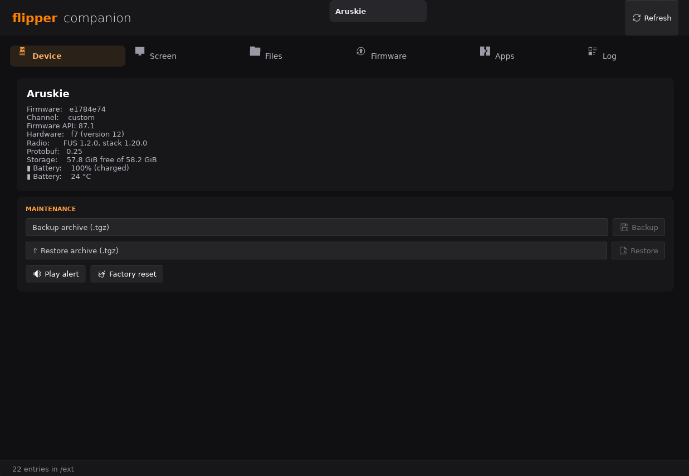
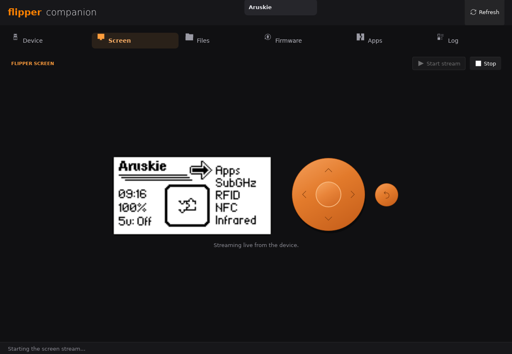
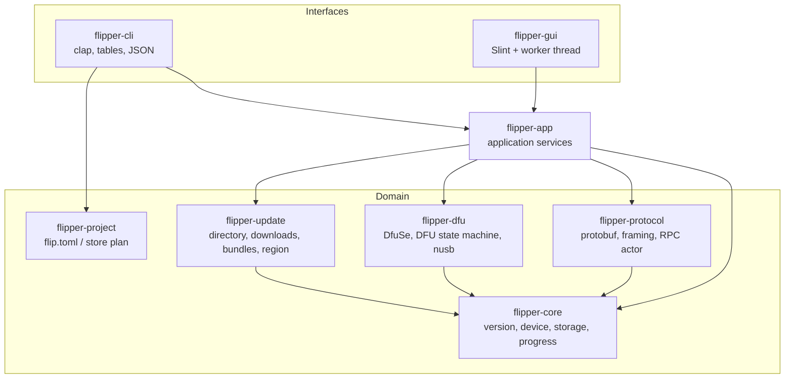
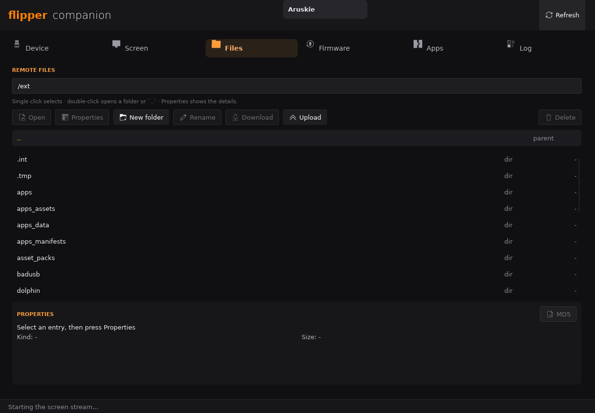
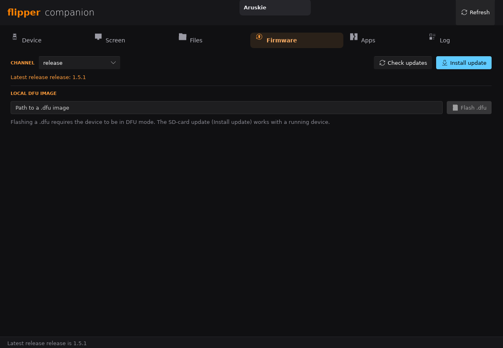
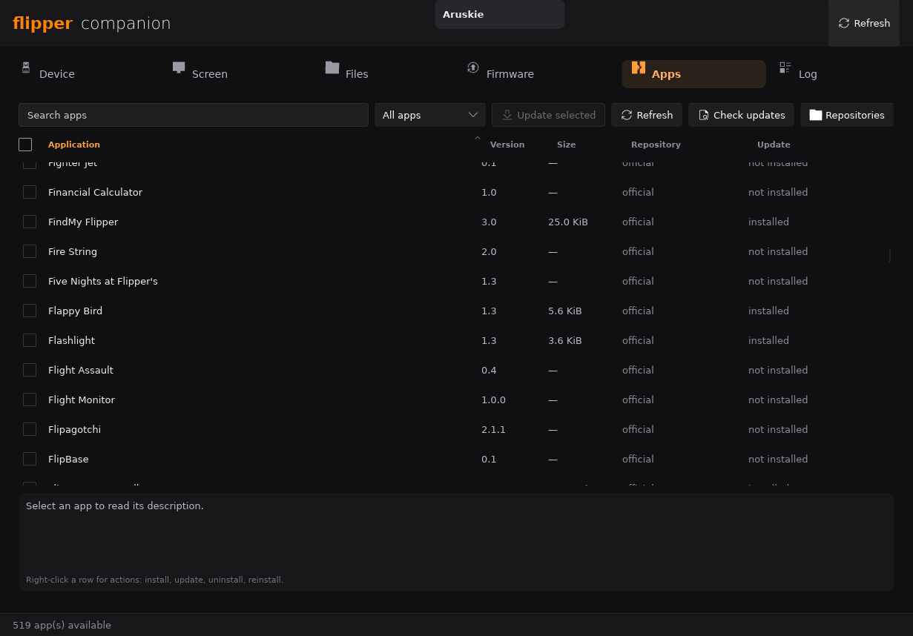
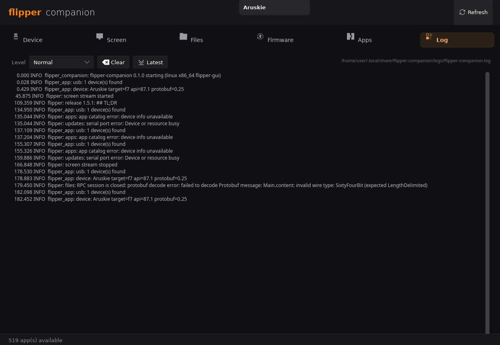

<p align="center">
  
</p>

# flipper-companion

A modern, memory-safe desktop and command-line companion for the
[Flipper Zero](https://flipperzero.one/), written in Rust.

The project is a from-scratch rewrite of the ideas behind
[qFlipper](https://github.com/flipperdevices/qFlipper): the same USB, DFU,
protobuf and firmware-update capabilities, but organised around a pure domain
model, typed errors, asynchronous I/O and a test suite that runs without
hardware.



Live screen mirroring and remote keypad:



> **Status:** early but functional. The DfuSe parser was validated byte-for-byte
> against official Flipper firmware images (DfuSe 1.5.1, CRC included), and the
> RPC, storage, screen and firmware-directory layers have automated tests. The
> application is not affiliated with Flipper Devices.

## What works today

| Capability | CLI | GUI | Notes |
|---|---|---|---|
| USB device discovery (VCP + DFU) | `flipper devices` | ✅ | Pure-Rust `nusb`, hotplug-ready |
| Device information over RPC | `flipper info` | ✅ | Modern `devinfo` property, legacy fallback |
| Validate a `.dfu` image offline | `flipper validate` | — | Strict bounds + CRC checks |
| Flash a `.dfu` image over DFU | `flipper flash` | ✅ | Erase/write progress, no manifest request (matches official client) |
| Remote storage | `flipper storage ...` | ✅ | list, stat, info, properties (time, entries, MD5 on demand), read, write, mkdir, rm, mv, md5, timestamp, tar-extract |
| Screen capture | `flipper screen` | — | ASCII or binary PBM |
| **Live screen mirroring + keypad** | `flipper input` | ✅ | 128×64 RGBA stream, Up/Down/Left/Right/OK/Back (Press→Short→Release) |
| File manager | `flipper storage ...` | ✅ | browser with `..` parent row, double-click/Open navigation, Enter-to-open path, properties panel (path, type, size, mtime, entry count, MD5 button), download, upload, mkdir, rename, delete |
| Backup / restore internal storage | `flipper backup` / `restore` | ✅ | qFlipper-compatible `int/` `.tgz` archives |
| Factory reset | `flipper factory-reset` (`erase`) | ✅ | two-step confirmation in the GUI |
| Power / battery information | `flipper power` | ✅ | charge, voltage, current, temperature, health |
| Desktop lock / app control / GPIO | `flipper desktop`, `app`, `gpio` | — | firmware extras, with confirmations for writes |
| Radio region provisioning | `flipper region` | — | fetches the official band database |
| STM32WB55 recovery info | `flipper recovery info` | — | OTP/factory info, option bytes, FUS, radio versions |
| Recovery writes (boot mode, radio/FUS) | `flipper recovery ...` | — | advanced, explicit confirmation |
| Reboot to OS/DFU/update | `flipper reboot` | — | |
| Firmware directory | `flipper firmware list` | ✅ | Channels, releases, changelogs; channel persisted in the GUI |
| Download with SHA-256 verification | `flipper firmware download` | — | Streamed, verified, removed on mismatch |
| Install an update bundle (SD + `System_update`) | `flipper firmware install` | ✅ | Uploads to `/ext/update`, verifies MD5, starts the updater |
| Download + flash latest firmware | `flipper firmware flash` | — | Reboots a running device into DFU first |
| App catalog and FAP installation | `flipper apps list/install/installed/uninstall` | ✅ | Official catalog + custom JSON sources, repository selector, uninstall, target/API detection |
| Project-side `flip.toml` (flippy-compatible) | `flipper project ...` | — | new, map repo/firmware, store create/fetch-plan |

Distribution-only items are still out of scope (see
[docs/migration.md](docs/migration.md)): self-update, signed Windows/macOS
packages and translations. Recovery **writes** are implemented but have not
been exercised on hardware; only the read-only path was validated.

## Architecture at a glance



The dependency rule is simple: **interfaces depend on application services,
application services depend on domain crates, and `flipper-companion-core` depends on
nothing.** There is no global mutable state, no plugin loader and no `unsafe`
code.

More diagrams, sequence flows and the ownership model are in
[docs/architecture.md](docs/architecture.md). The wire protocol is documented in
[docs/protocol.md](docs/protocol.md) and the app catalog format in
[docs/apps.md](docs/apps.md).

## Quick start

### Prerequisites

- Rust stable (edition 2024; tested with 1.99)
- Linux: `libudev`, OpenSSL headers, fontconfig/freetype, Wayland or X11
- A Flipper Zero (optional for building and for most tests)

On Fedora/Bazzite:

```sh
sudo dnf install openssl-devel fontconfig-devel freetype-devel \
    libxkbcommon-devel wayland-devel mesa-libGL-devel
```

### Build and test

```sh
make            # debug build of the whole workspace
make release    # optimized binaries
make test       # 99 tests, no hardware required
make check      # fmt-check + clippy + test, same as CI
make run        # launch the Slint desktop application
```

Cargo works just as well:

```sh
cargo build --workspace
cargo test --workspace
cargo clippy --workspace --all-targets -- -D warnings
cargo fmt --all -- --check
```

The GUI binary is `target/debug/flipper-companion`; the CLI is
`target/debug/flipper`. Run `make help` for every shortcut.

The GUI has four tabs: **Device** (details, power, backup/restore, factory
reset, alert), **Screen** (live mirroring and keypad), **Files** (remote
browser with download/upload/mkdir/rename/delete), and **Firmware** (channel,
update check/install, local `.dfu` flash).

### USB permissions (Linux)

```sh
make install-udev          # copies the rule and reloads udev (asks for root via su -)
```

Or manually, with `sudo` or `su -`:

```sh
install -m 0644 udev/42-flipperzero.rules /etc/udev/rules.d/
udevadm control --reload-rules && udevadm trigger --subsystem-match=tty
```

The rule uses `uaccess`, so no group change or logout is required on systems
with systemd-logind. In a session without a seat (SSH, some containers),
`uaccess` does not apply; add your user to `dialout` and log in again:

```sh
sudo usermod -aG dialout "$USER"
```

### Run

```sh
# List connected devices and probe their firmware
flipper devices

# Validate an image without touching hardware
flipper validate flipper-z-f18-full-1.5.1.dfu

# Put the device in DFU mode, then flash it
flipper reboot --mode dfu
flipper flash flipper-z-f18-full-1.5.1.dfu

# One-shot: reboot, download the latest release, verify, flash
flipper firmware flash --channel release --yes

# Browse remote storage
flipper storage ls /ext
flipper storage read /ext/Manifest --output Manifest
flipper storage timestamp /ext/Manifest
flipper storage properties /ext/Manifest --md5

# Backup and restore internal storage
flipper backup internal.tgz
flipper restore internal.tgz --yes

# Power, alert, desktop, apps, GPIO
flipper power
flipper alert
flipper desktop status
flipper app status
flipper gpio mode PC0

# Region data and recovery (advanced)
flipper region --country FR --yes
flipper recovery info

# Browse and install Flipper apps
flipper apps list --query timer
flipper apps install cube_timer --yes
flipper apps installed
flipper apps outdated
flipper apps uninstall cube_timer --yes

# Project-side configuration (flippy-compatible)
flipper project new sd
cd sd
flipper project map firmware set momentum
flipper project map repo add https://github.com/Lucaslhm/Flipper-IRDB irdb
flipper project store fetch --optimize

# Capture the screen
flipper screen --format ascii
flipper screen --format pbm --output screen.pbm

# Desktop application
cargo run -p flipper-companion
```

All commands support `--json` where a machine-readable output makes sense.

## Testing

```sh
cargo test --workspace          # 99 tests, no hardware required
```

Optional validation against a real image:

```sh
FLIPPER_TEST_DFU=/path/to/full_firmware.dfu \
    cargo test -p flipper-companion-dfu --test real_image
```

The tests cover:

- version/release ordering (including `-rcN` and development commits);
- device property parsing (modern and legacy);
- DfuSe container parsing, CRC and malformed inputs;
- every DFU control-transfer sequence, using a scripted transport;
- protobuf framing (fragmentation, concatenation, oversized frames);
- RPC correlation, multi-part responses and multi-request writes, using a
  fake device on an in-memory duplex pipe;
- update-directory parsing, artifact selection, SHA-256 validation and safe
  archive extraction;
- screen-frame validation and PBM/ASCII rendering.

No test opens a serial port or a USB device.

## Safety notes

- Flashing firmware is inherently risky. The tool validates the DfuSe CRC and
  every length before the first USB transfer, but a power loss during flashing
  can still leave the device in DFU mode.
- Hardware recovery features that depend on STM32WB55 option bytes and FUS
  (wireless stack repair) are not implemented yet.
- The GUI only flashes devices already in DFU mode. The CLI can reboot a
  running device into DFU and wait for it.

## Screenshots

<p>


</p>
<p>


</p>

## Installation

Release tarballs (`.tar.gz`), Debian (`.deb`) and RPM (`.rpm`) packages are
attached to the GitHub and GitLab releases. The packages install both
binaries (`flipper` for the CLI, `flipper-companion` for the desktop
application), the udev rule and the documentation.

```sh
# Debian / Ubuntu
sudo apt install ./flipper-companion_0.8.1-1_amd64.deb

# Fedora / RHEL
sudo dnf install ./flipper-companion-0.8.1-1.x86_64.rpm
```

The desktop application links against the system font and TLS stacks
(fontconfig, freetype, OpenSSL), which the packages pull in automatically.

### From source

```sh
cargo build --release --workspace   # target/release/flipper, target/release/flipper-companion
```

Runtime dependencies for the GUI: fontconfig, freetype, a Wayland or X11
session and OpenSSL.

### Release process

Version lives in `[workspace.package]` in `Cargo.toml`. Pushing a `v<version>`
tag builds both architectures, creates the `.deb`/`.rpm` packages, attaches
them to the release and publishes the crates to crates.io. Locally:

```sh
make dist            # tarball + .deb/.rpm (requires nfpm)
make publish-crates  # crates.io, in dependency order
make anonymity       # personal data check (also runs in the pre-push hook)
make hooks           # install the pre-push personal data check
```

The `release` workflow needs a `CARGO_REGISTRY_TOKEN` secret to publish the
crates; the GitHub release itself uses the automatic `GITHUB_TOKEN`.

## Licence

**AGPL-3.0-or-later.** The project started as a from-scratch Rust rewrite of
[qFlipper](https://github.com/flipperdevices/qFlipper) (GPL-3.0-or-later) and
reuses the protocol definitions from
[flipperdevices/flipperzero-protobuf](https://github.com/flipperdevices/flipperzero-protobuf)
(GPL-3.0-or-later); the firmware's RPC handlers were used as a behavioural
reference. The Breeze icons are LGPL-3.0-or-later. See [LICENSE](LICENSE) and
[NOTICE.md](NOTICE.md) for the exact attributions.
