# Architecture

## 1. Layers and dependency rule

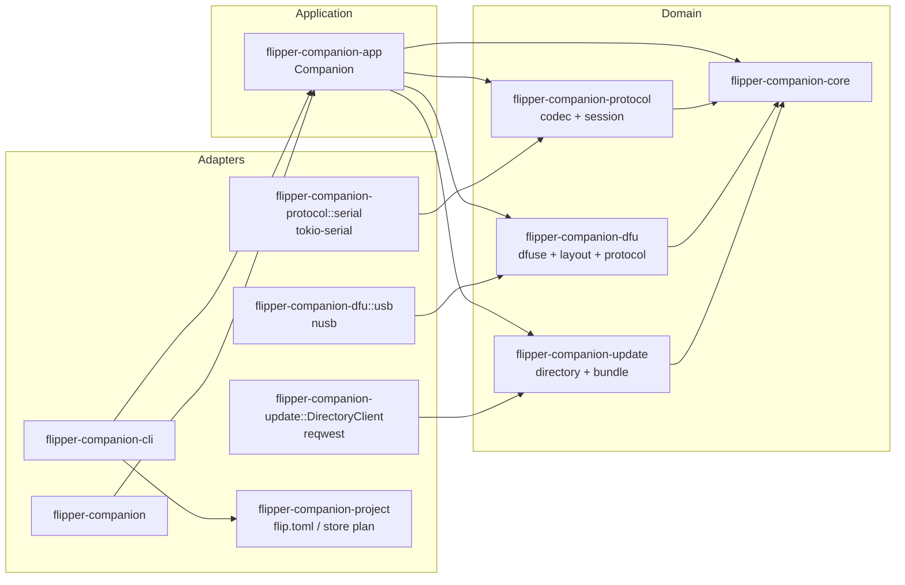

Dependencies point inwards only. `flipper-companion-core` has no dependencies at all; it
can be tested with plain data and reused by any front end.

| Crate | Responsibility | Notable dependencies |
|---|---|---|
| `flipper-companion-core` | Versions, release channels, build dates, device properties, storage, progress | `thiserror` |
| `flipper-companion-dfu` | DfuSe parser, memory layout, DFU state machine, USB discovery/transport | `nusb` |
| `flipper-companion-protocol` | Vendored `.proto`, prost codegen, varint framing, RPC actor, serial handshake, screen frames | `prost`, `protox`, `tokio`, `tokio-serial` |
| `flipper-companion-update` | Update directory, streamed downloads, SHA-256, `.tgz` extraction | `reqwest`, `sha2`, `tar`, `flate2` |
| `flipper-companion-project` | flippy-compatible `flip.toml`, sources, store/fetch plan | `toml`, `url`, `serde` |
| `flipper-companion-app` | `Companion`: scan, probe, connect, flash, download, backup, recovery, screen capture | all domain crates |
| `flipper-companion-cli` | `flipper` binary, clap grammar, tables, JSON | `clap`, `anyhow` |
| `flipper-companion` | Slint window + worker thread | `slint` |

## 2. Flash flow

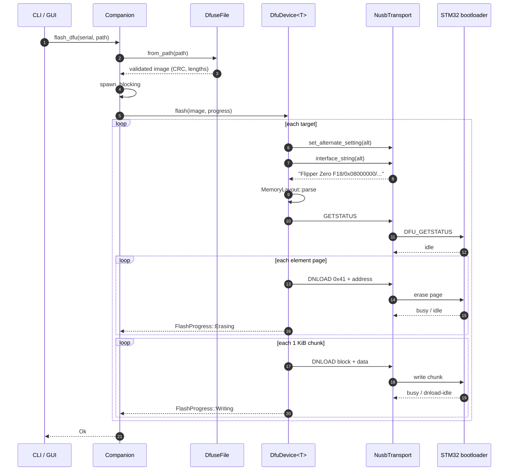

Why a generic `Transport`? The whole sequence above is tested with a scripted
mock that records every control request and replays `GETSTATUS` replies. No
device, no USB permission and no timing involved. The `nusb` adapter is a thin
mapping from the trait to control transfers.

### DFU state machine

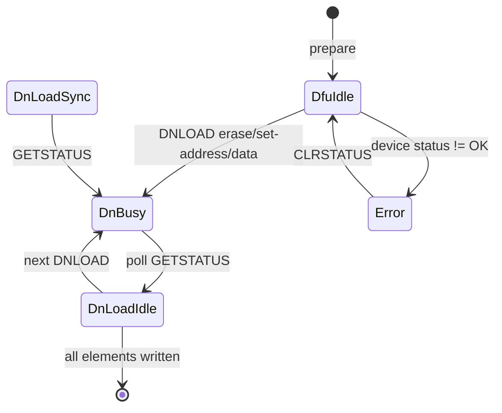

The implementation waits for `DnLoadIdle` rather than only "not `DnBusy`",
which also handles devices that report the intermediate `DnLoadSync` state.
Every wait has a 60-second deadline.

## 3. RPC actor

The serial protocol is request/response with three twists:

1. frames are varint-length-delimited, so reads may be partial;
2. a response may be split into several frames (`has_next == true`);
3. a write is split into several requests under one `command_id`.

A single actor owns the socket and the pending-request table:

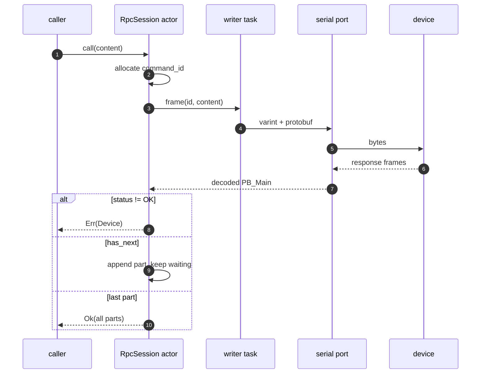

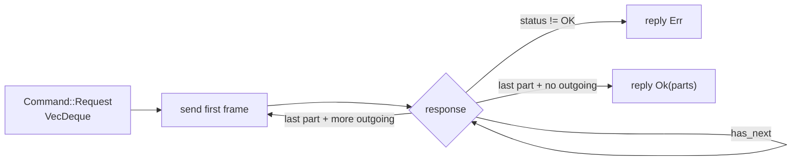

The writer lives in its own task, which removes the borrow conflict between
"read the next frame" and "write the next chunk" and keeps the actor loop
readable.

Unmatched responses are logged and dropped; broadcast frames (`command_id ==
0`, e.g. screen frames) go to a `broadcast` channel.

## 4. Update flow

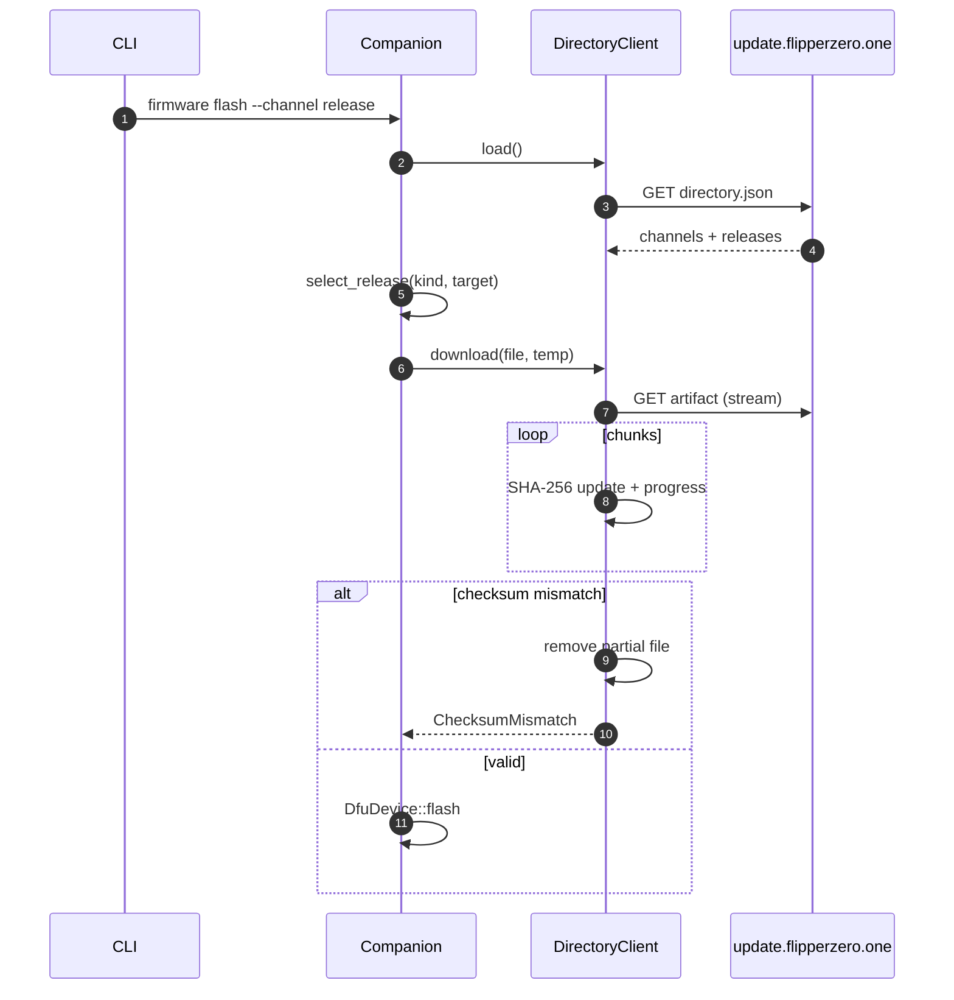

The SD-card path is different: the `update_tgz` bundle is extracted, each file
is compared with the remote MD5, uploaded only when it differs, verified after
upload, and then `System_update` is called with the remote `update.fuf` path.

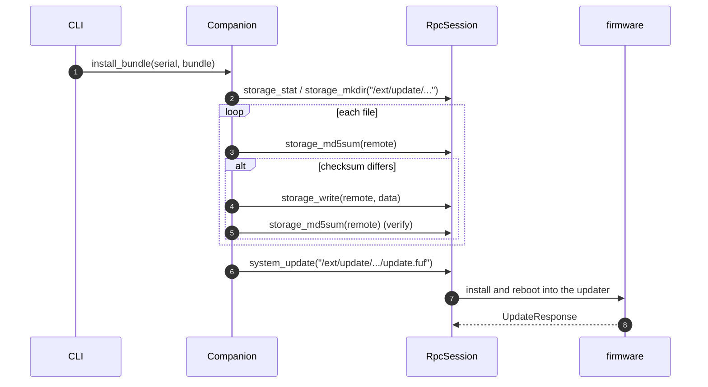

Bundles are extracted with path-traversal checks (`Component::ParentDir`,
`RootDir`, `Prefix` are rejected, and symlinks/hard links are refused) and the
`update.fuf` manifest is located recursively.

## 4.1 Backup and restore

A backup walks `/int` recursively, downloads every file into a temporary
`int/` tree, and creates a qFlipper-compatible `.tar.gz` archive. A restore
extracts the archive with the same path-traversal checks as update bundles,
removes only the paths present in the backup, recreates directories and
uploads files. Progress is reported in bytes.

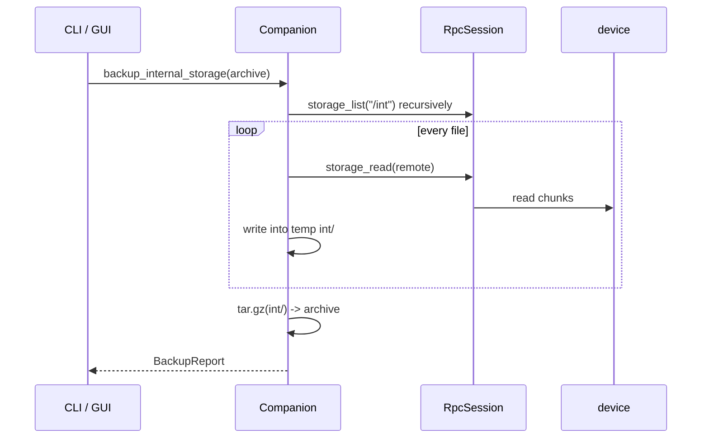

Restore performs the inverse: `extract_tar_gz`, delete archived paths (deepest
first, tolerating absent entries), `storage_mkdir` (tolerating existing
directories), then `storage_write` every file and verify the result by size.

## 4.2 Screen streaming

The GUI worker opens an RPC session, starts `Gui_start_screen_stream_request`
and listens to broadcast frames. Each `Gui_screen_frame` is converted from
the firmware's 128×64 **page-major (SSD1306)** 1-bit buffer to RGBA8
(`ScreenFrame::to_rgba`) and sent to the UI thread,
which wraps it in `slint::Image::from_rgba8`. Keypad presses go back over the
same session as `Gui_send_input_event_request` with `InputType::SHORT`.
Frames are throttled to 20 fps and the broadcast channel drops stale frames
when the UI cannot keep up.

## 4.3 Recovery

Recovery uses the same DFU transport but different alternate settings:

| Operation | Address | Alternate |
|---|---|---|
| Option bytes | `0x1FFF8000` | 1 |
| OTP / factory info | `0x1FFF7000` | 2 |
| FUS state | `0xFFFF0054` | 0 |
| Radio version table | `SRAM2A` pointer | 0 |
| Radio/FUS images | computed from SFSA | 0 |

`DfuDevice::upload` implements the DFU upload sequence; `Wb55` wraps the
STM32WB55-specific addresses and parsers. Read operations are safe; writes
(option bytes, radio/FUS images) are exposed only through `recovery`
subcommands with explicit confirmation and are not run automatically.

## 5. GUI threading

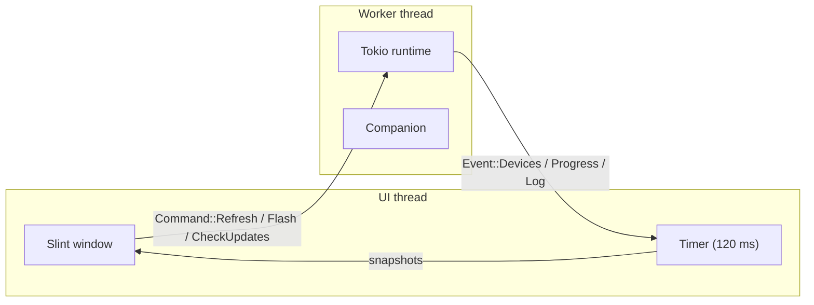

The window is organised as four tabs (Device, Screen, Files, Firmware) plus a
persistent log pane. The worker owns every RPC/USB/HTTP operation; the UI only
sends commands and renders snapshots.

Rules:

- Slint types never cross threads. The worker sends plain `Send` structs
  (`DeviceView`, `FileView`, `String`, `f32`, RGBA `Vec<u8>`).
- The UI timer drains events and rebuilds the device/file models; no blocking
  call runs on the UI thread.
- Progress is throttled to one event per percentage point.
- The screen stream runs in its own Tokio task with a cancellation channel and
  an input channel; starting a new stream stops the previous one first.

## 6. Error model

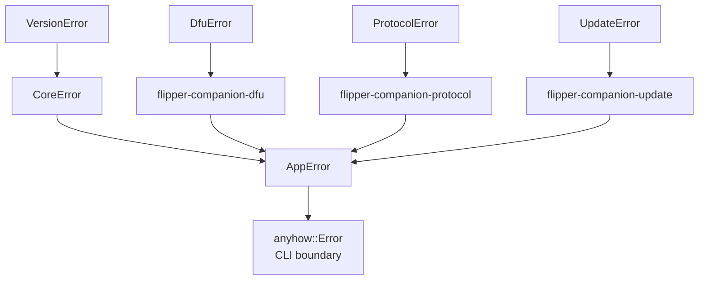

- Domain crates expose one `thiserror` enum each.
- `AppError` composes them with `#[from]` and adds application-level cases
  (`NoDfuDevice`, `ProbeTimeout`, `ScreenTimeout`, `MissingArtifact`).
- The CLI uses `anyhow` for context and exit reporting; the GUI logs the
  `Display` form.
- No error string is produced without a typed variant first.

## 7. Resource and safety invariants

| Invariant | Enforcement |
|---|---|
| Never flash a corrupt image | `DfuseFile::parse` validates signature, version, declared size, target count, element bounds, target sizes and CRC |
| Never run an unbounded loop | DFU waits have a 60-second deadline; layout geometry is capped at 64 MiB |
| Never allocate an unbounded frame | `MAX_FRAME_SIZE` = 16 MiB |
| Never write outside the destination directory | Archive entries with `..`, absolute or prefix components are rejected |
| Never keep a partial download | The file is removed on checksum mismatch |
| Never block the UI | All I/O happens on the worker thread / blocking pool |
| Never leave a USB session hanging | `Device`/`Interface` are dropped when `NusbTransport` drops; the RPC actor fails pending calls when the stream closes |
| Never write option bytes/radio firmware by accident | Recovery writes require explicit `--yes`, with a warning on stderr |
| Never leave a partial backup | Archives are written only after the full file tree has been downloaded; restore rejects unsafe archive paths |
| Never leak a device handle | No `unsafe`, no `mem::forget` on resources (only the Slint `Timer` self-reference) |

## 8. Testing strategy

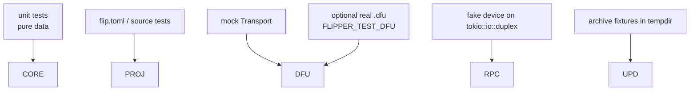

- **DFU:** a `MockTransport` queues `GETSTATUS` replies and records control
  transfers. The test asserts the exact erase/address/write sequence.
- **RPC:** a fake device runs the same `FrameCodec` on the other end of a
  duplex pipe and answers typed requests. Tests cover multi-part reads,
  multi-request writes, device errors and ping echo.
- **Update:** a synthetic `.tgz` is built in a temporary directory and
  extracted; manifest parsing is tested with a representative JSON document.
- **Project configuration:** flippy-compatible `flip.toml` round-trips, source
  parsing and fetch-plan generation are tested in `flipper-companion-project`.
- **Recovery:** option bytes, factory info, FUS state and radio version tables
  are parsed from synthetic bytes; DFU upload is tested with the scripted
  transport.
- **Screen:** 1-bit frames are checked for PBM, ASCII and RGBA output.
- **Real image:** an opt-in integration test validates an official `.dfu`
  (including the CRC) when `FLIPPER_TEST_DFU` is set.

## 9. Extending the project

### Add an RPC command

1. Confirm the message exists in `crates/flipper-companion-protocol/proto/*.proto`.
2. Add a typed helper to `RpcSession` (most are 10–20 lines: build content,
   match response).
3. Use the typed `StorageEntry`/`StorageInfo`/`DeviceInfo` domain types rather
   than exposing prost types to callers.
4. Add a fake-device branch and a test.

### Add an update artifact type

1. Add the artifact kind to the `Release::file(kind, target)` lookup (no code
   change needed; kinds are strings from the directory).
2. Add a selection/validation step in `flipper-companion-app` or the CLI.
3. If the artifact is an archive, reuse `FirmwareBundle::extract` and its path
   checks.

### Add a front end

Implement the `flipper-companion-app::Companion` API in any language through FFI, or
call the CLI with `--json`. The application layer does not depend on Slint or
clap.
