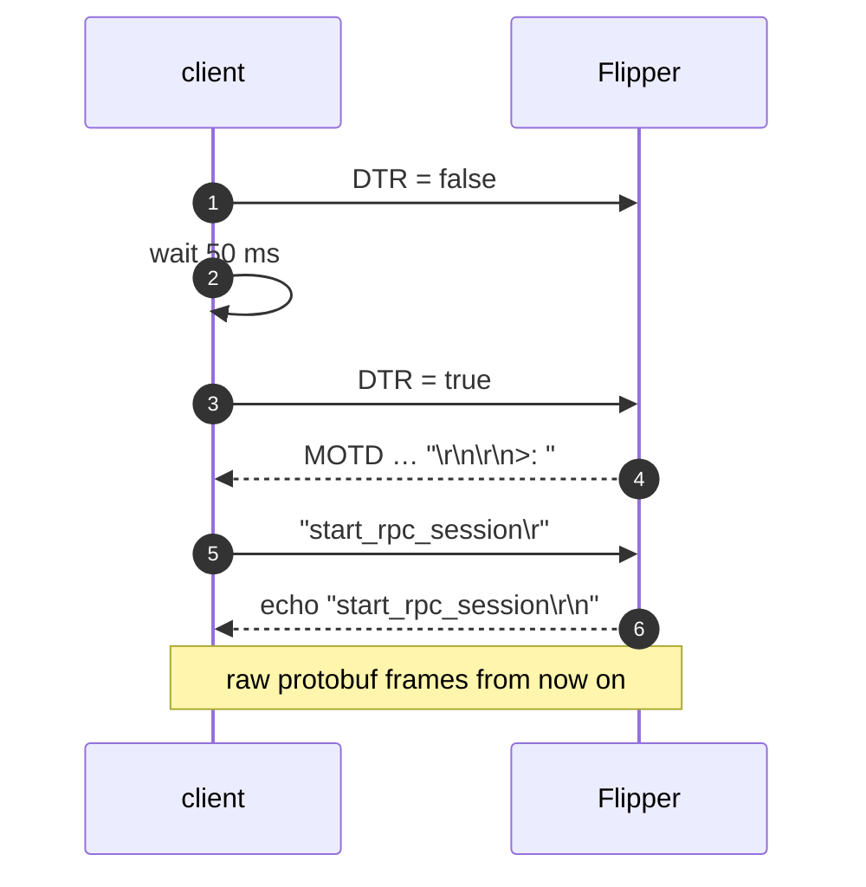
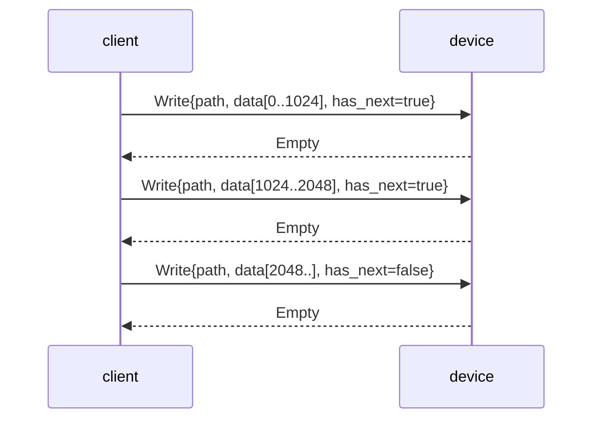

# Wire protocol notes

Everything here was derived from the qFlipper implementation and verified
against official firmware images and the vendored `.proto` files.

## 1. USB personalities

| PID | Mode | Driver | Used for |
|---|---|---|---|
| `0x5740` | CDC-ACM virtual COM port | `cdc_acm` (Linux), built-in (macOS/Windows) | RPC service |
| `0xdf11` | STM32 system bootloader (DFU) | none; `nusb` claims interface 0 | Firmware flashing |

Both use vendor ID `0x0483`. The two modes can appear as separate devices if
Linux enumerates the composite device's DFU interface, but on a running Flipper
only the VCP personality is exposed.

## 2. Serial handshake

The RPC service lives behind the CLI. A DTR toggle resets the CLI state, then
the client waits for the prompt and starts the service:



Timeouts are 2 seconds for the prompt and 2 seconds for the echo. The prompt is
advisory: some firmware configurations do not print a MOTD, so the client
proceeds after the timeout. The echo is required.

Reference: `crates/flipper-protocol/src/serial.rs`.

## 3. Framing

Each `PB_Main` is encoded with protobuf's *delimited* form: a varint length
followed by the message body. This is exactly what nanopb's
`PB_ENCODE_DELIMITED`/`PB_DECODE_DELIMITED` produce.

```text
+----------------+---------------------------+
| varint length  | protobuf PB_Main bytes    |
+----------------+---------------------------+
   1..5 bytes          `length` bytes
```

The decoder is incremental: it scans at most five bytes for the prefix, waits
until the whole body is buffered, then hands the frame to `prost`. Maximum
frame size is 16 MiB (`MAX_FRAME_SIZE`).

### `PB_Main`

```protobuf
message Main {
    uint32 command_id = 1;
    CommandStatus command_status = 2;
    bool has_next = 3;
    oneof content { ... }
}
```

- `command_id` correlates a response with a request. `0` means an unsolicited
  broadcast (screen frames, desktop status).
- `command_status` is `OK` (0) on success and one of the documented errors
  otherwise.
- `has_next` has two distinct meanings:
  - **in a response:** the same command has more frames (storage reads,
    property lists);
  - **in a request:** the same command has more client frames (storage writes).
- An unknown `command_id` in a response is logged and dropped.

## 4. Multi-part operations

### Storage read

The client sends one `Storage_read_request`. The device answers with one or
more `Storage_read_response` frames; every frame except the last has
`has_next = true`. The session concatenates `file.data` from every part.

### Storage write

The client splits the file into 1 KiB chunks. Every `Storage_write_request`
carries `has_next = true` except the last. The device answers each chunk with
an `Empty` response (optionally a `System_ping_response` used as a progress
keep-alive by the official client). The session sends the next chunk only
after the previous response.



## 5. Device information

Two generations exist:

| Protobuf version | Request | Keys |
|---|---|---|
| ≥ 0.14 | `Property_get_request { key: "devinfo" }` | `hardware.name`, `firmware.version`, `firmware.commit.hash`, `hardware.target`, … |
| < 0.14 | `System_device_info_request` | `hardware_name`, `firmware_version`, `firmware_commit`, `hardware_target`, … |

Both are multi-part: one `key`/`value` pair per response. `DeviceInfo` maps
either set into the same domain type; the legacy parser is a key-table swap,
not a duplicated code path.

## 6. DFU protocol

Requests are class/interface control transfers:

| Request | Value | Direction | Purpose |
|---|---|---|---|
| `DFU_DNLOAD` (1) | block number | OUT | erase (`0x41 + addr`), set address (`0x21 + addr`), data, manifest |
| `DFU_UPLOAD` (2) | block number | IN | read flash (not used yet) |
| `DFU_GETSTATUS` (3) | 0 | IN (6 bytes) | status, poll timeout, state, string index |
| `DFU_CLRSTATUS` (4) | 0 | OUT | clear error |
| `DFU_ABORT` (6) | 0 | OUT | abort to idle |

Status layout:

```text
byte 0      bStatus
bytes 1..3  bwPollTimeout (24-bit little-endian, milliseconds)
byte 4      bState
byte 5      iString
```

Erase is a `DNLOAD` with a five-byte payload: `0x41` followed by the 32-bit
little-endian page address. Setting the address pointer uses the same shape
with `0x21`. The client then polls `GETSTATUS` until the state is
`DFU_DNLOAD_IDLE` (5) or the 60-second deadline expires.

Data blocks start at block number 2 and increment for every chunk. Chunk size
is read from the DFU functional descriptor (`wTransferSize`, offset 5),
clamped to 4096 bytes.

The official client does not send a final zero-length manifest request; this
rewrite mirrors that behaviour for compatibility.

### Entering DFU mode

- CLI: `flipper reboot --mode dfu` sends `System_reboot_request { mode: DFU }`.
- Manual: hold the DFU button combination while plugging the device.

## 7. DfuSe container

```text
offset  size  field
0       5     "DfuSe"
5       1     version (1)
6       4     image size = file size - 16
10      1     target count
11      ...   targets
end-16  2     bcdDevice
end-14  2     idProduct
end-12  2     idVendor
end-10  2     bcdDFU
end-8   3     "UFD"
end-5   1     suffix length (16)
end-4   4     CRC-32
```

Each target:

```text
0    6     "Target"
6    1     alternate setting
7    4     named flag (0/1)
11   255   target name, NUL padded
266  4     target size = sum(8 + element length)
270  4     element count
274  ...   elements: address (u32), length (u32), payload
```

The parser rejects: bad signatures, unsupported versions, size mismatches,
zero targets, implausible element counts, element sizes beyond the file,
target sizes that do not match their elements, trailing bytes and CRC
mismatches.

### CRC variant

DfuSe stores the standard reflected CRC-32 (polynomial `0xEDB88320`, initial
value `0xFFFFFFFF`) **without the final XOR**. This was verified against
official `full_dfu` images: the stored value equals
`crc32(data[..len-4])` with no complement. `crates/flipper-dfu/src/crc.rs`
implements exactly that variant and has a known-answer test.

## 8. Memory layout descriptor

A DFU alternate setting advertises its geometry as a string descriptor:

```text
Flipper Zero F18/0x08000000/4*1024Kg,2*64Kg,1*128Kg
|            | |          |            |
name          base       banks        bank: page_count * page_size
```

- `K` = ×1024, `M` = ×1024×1024.
- The trailing letter (`g`) is the sector type used by ST tools.
- The page list always includes the requested start address, then every sector
  boundary strictly inside the range.
- Geometries larger than 64 MiB are rejected to bound iteration.

## 9. Screen frames

`Gui_screen_frame` broadcasts carry the raw 128×64 monochrome framebuffer:
1024 bytes in **SSD1306 page-major** order. Each byte holds eight vertical
pixels:

```text
byte  = data[(y / 8) * 128 + x]
pixel = byte & (1 << (y % 8))
```

This is *not* row-major, and it is not the same packing as PBM. The firmware
uses the opposite (row-major) layout for frames sent to a virtual display, which
is why the official client has a `transposeImage` helper. `ScreenFrame::to_rgba`
and `to_pbm` decode the page-major stream layout; `to_pbm` converts it back to
rows of 16 bytes, MSB first, before adding the `P4` header. Getting this wrong
produces the characteristic wide horizontal zebra stripes.

## 10. Firmware extras

The `PB_Main` oneof exposes more commands than qFlipper's GUI uses. The
following are implemented and exposed through the CLI:

| Command | Response | Notes |
|---|---|---|
| `System_power_info_request` | `System_power_info_response` × N | `charge_level`, `charge_state`, `battery_voltage` (mV), `battery_current` (mA), `battery_temp` (°C), `battery_health`, `capacity_remain/full` (mAh) |
| `System_play_audiovisual_alert_request` | `Empty` | buzzer + vibration |
| `Desktop_is_locked_request` | `Empty` | status `OK` = locked, `ERROR` = unlocked |
| `Desktop_unlock_request` | `Empty` | |
| `Desktop_status_subscribe_request` | `Empty`, then `Desktop_status` broadcasts | `command_id = 0`, `locked: bool` |
| `App_start_request` | `Empty` | starts an app by name; `args = "RPC"` is rewritten by the firmware with the RPC context |
| `App_lock_status_request` | `App_lock_status_response` | loader locked |
| `App_exit_request`, `App_load_file_request`, `App_button_press_request`, `App_button_release_request` | `Empty` | forwarded to the running app |
| `App_get_error_request` | `App_get_error_response` | last app error |
| `Gpio_get_pin_mode`, `Gpio_read_pin` | typed responses | read-only |
| `Gpio_set_pin_mode`, `Gpio_set_input_pull`, `Gpio_write_pin` | `Empty` | physical pin changes, confirmed in the CLI |
| `Gpio_get_otg_mode` / `Gpio_set_otg_mode` | typed / `Empty` | 5 V output |
| `Storage_timestamp_request` | `Storage_timestamp_response` | device-side mtime |
| `Storage_tar_extract_request` | `Empty` | extracts a tar already on the SD card |
| `Gui_send_input_event_request` | `Empty` | send Press → Short → Release; a bare Short is ignored by the firmware's sequence tracker |

## 11. Region data

`/int/.region_data` is a protobuf `PB_Region` message (not wrapped in
`PB_Main`):

```protobuf
message Region {
    bytes country_code = 1;      // "FR", "US", ...
    repeated Band bands = 2;
}
message Band {
    uint32 start = 1;            // Hz
    uint32 end = 2;
    int32 power_limit = 3;
    uint32 duty_cycle = 4;
}
```

The band database is fetched from
`https://update.flipperzero.one/regions/api/v0/bundle`. The client selects the
country from `--country`, then the server-detected country, then the POSIX
locale; unknown countries fall back to the bundle's default list. Region `0`
in the factory information is development hardware and is skipped.

## 12. Backup format

Backups are `.tar.gz` archives with a single top-level `int/` directory that
mirrors `/int`. They are byte-compatible with qFlipper's internal-storage
backup: restore accepts qFlipper archives and qFlipper accepts ours. Archive
extraction rejects absolute paths, `..`, symlinks, hard links and device
nodes.

## 13. STM32WB55 recovery

Recovery uses the DFU **upload** path (`DFU_UPLOAD` block 2, 3, …) and the
following addresses:

| Data | Address | Alternate |
|---|---|---|
| Option bytes (128 B) | `0x1FFF8000` | 1 |
| OTP (1 KiB) | `0x1FFF7000` | 2 |
| FUS status (2 B) | `0xFFFF0054` | 0 |
| Version table pointer | `0x20030000` | 0 |
| FUS/radio images | `SFSA`-derived | 0 |

Option-byte boot fields: `nBOOT0` (word 1, bit 27) and `nSWBOOT0` (bit 26),
with inverted copies in the complement word at offset 4. `SFSA` is the low byte
of word 9 at offset 112. Radio images are placed at
`base + 0x1000 * SFSA - image_size`, rounded down to a 4 KiB page.

FUS commands are raw `DNLOAD` block 0 transfers: `0x52` (delete), `0x53`
(upgrade), `0x5A` (start wireless stack). The FUS state bytes are
`(status, error)`; `0xFF/0xFE` means "error occurred / not running", which is
normal when the wireless stack is stopped.

## 14. Compatibility notes

- The firmware may expose a newer protobuf revision than the vendored `.proto`.
  `prost` ignores unknown fields, so forward compatibility is preserved as long
  as the oneof tags used by this client keep their meaning.
- `System_update` expects a manifest path on the SD card. `flipper firmware
  install` uploads the extracted `update_tgz` contents to
  `/ext/update/<dir>`, verifies each file with the device-side MD5, then calls
  `System_update` with the remote `update.fuf` path. The path has not yet been
  validated on hardware.
- STM32WB55 FUS operations (wireless stack repair, option bytes) use
  vendor-specific DFU requests documented in AN5185. They are out of scope for
  the current milestone.
